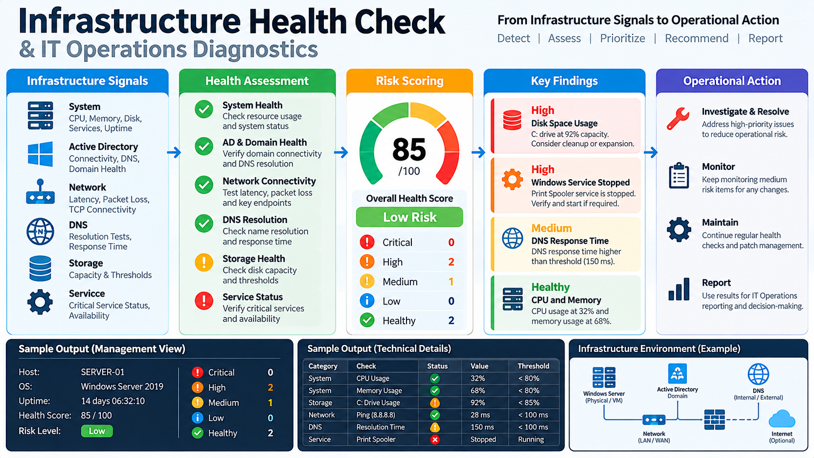

# Infrastructure Health Check & IT Operations Diagnostics



> **Project visual — turning infrastructure signals into health assessment, risk prioritization and operational action.**

> Professional proof of concept | IT Infrastructure | IT Operations | Monitoring | Risk Prioritization | Automation

A safe, reproducible infrastructure health-check proof of concept designed to demonstrate how an IT Operations team can move from **technical checks to operational risk visibility and management-ready reporting**.

**Author:** Shahid Al Parvez Malik  
**Positioning:** Senior IT Infrastructure & Service Delivery Manager | IT Operations | ITSM | Infrastructure | Automation

## Purpose

Infrastructure problems are often discovered through individual alerts, user reports, or reactive troubleshooting.

This project demonstrates a structured operating approach:

**Detect → Assess → Prioritize → Recommend → Report → Improve**

The proof of concept covers common infrastructure health indicators across:

- Windows / server resources
- Disk capacity
- Critical service state
- Network connectivity
- DNS resolution
- Endpoint availability
- Basic operational risk scoring

## Important Safety Note

This is a **portfolio proof of concept**.

It is designed to be safe to execute without access to employer or customer systems. The repository can run against the local machine or supplied test targets, and its example reporting uses synthetic/sample diagnostic results.

**No employer, customer, production or confidential infrastructure data is included.**

## What the Project Demonstrates

### 1. System Health

Checks can include:

- CPU utilization
- Memory utilization
- Disk free space
- System uptime
- Selected critical services

### 2. Network Health

Checks can include:

- Host reachability
- TCP connectivity to approved ports
- Latency measurement
- Packet-loss indicators where supported by the execution environment

### 3. DNS Health

Checks can include:

- DNS resolution success/failure
- Resolution response time
- Comparison of expected and observed addresses where configured

### 4. Service Health

The workflow can identify:

- Running services
- Stopped services
- Expected-but-missing services
- Services requiring attention

### 5. Availability

The project can assess whether approved endpoints or services respond as expected.

## Operational Risk Model

Technical findings are translated into an operational view:

| Risk | Meaning | Example |
|---|---|---|
| Critical | Immediate or potentially severe service risk | Critical service unavailable |
| High | Significant degradation or capacity risk | Disk nearly full |
| Medium | Condition that requires planned attention | Elevated resource utilization |
| Low | Informational or minor observation | Non-critical check warning |
| Healthy | No material issue detected | All baseline checks passed |

The objective is not simply to report technical measurements.

The objective is to help an IT Operations leader answer:

**What is unhealthy? → Why does it matter? → What should happen next?**

## Architecture

```text
                     ┌──────────────────────┐
                     │ Health Check Runner  │
                     └──────────┬───────────┘
                                ↓
       ┌────────────────────────┼────────────────────────┐
       ↓                        ↓                        ↓
┌──────────────┐        ┌──────────────┐        ┌──────────────┐
│ System       │        │ Network      │        │ DNS          │
│ Checks       │        │ Checks       │        │ Checks       │
└──────┬───────┘        └──────┬───────┘        └──────┬───────┘
       └────────────────────────┼────────────────────────┘
                                ↓
                     ┌──────────────────────┐
                     │ Service / Availability│
                     │ Checks                │
                     └──────────┬───────────┘
                                ↓
                     ┌──────────────────────┐
                     │ Health Scoring       │
                     │ Risk Prioritization  │
                     └──────────┬───────────┘
                                ↓
                     ┌──────────────────────┐
                     │ Management Report    │
                     │ + Technical Findings │
                     └──────────────────────┘
```

## Repository Structure

```text
infrastructure-health-check/
├── README.md
├── LICENSE
├── .gitignore
├── requirements.txt
├── config/
│   └── checks.json
├── src/
│   ├── system_checks.py
│   ├── network_checks.py
│   ├── dns_checks.py
│   ├── service_checks.py
│   ├── health_score.py
│   └── report.py
├── examples/
│   ├── run_sample.py
│   └── run_local.py
├── sample-data/
│   └── sample_report.json
├── docs/
│   ├── ARCHITECTURE.md
│   ├── CHECK_DEFINITIONS.md
│   ├── RISK_MODEL.md
│   └── LINKEDIN_ARTICLE.md
├── tests/
│   └── test_health_checks.py
└── .github/
    └── workflows/
        └── python.yml
```

## Getting Started

This project uses the Python standard library and does not require paid services or AI APIs.

```bash
python examples/run_sample.py
python examples/run_local.py
python -m unittest discover -s tests -p "test_*.py"
```

The sample runner produces a deterministic portfolio report using synthetic inputs. The local runner performs safe, read-only diagnostics against the current host and approved targets defined in `config/checks.json`.

### Local Diagnostic Runner

Run a read-only health check on the current machine:

```bash
python examples/run_local.py
```

Optionally write the results to JSON:

```bash
python examples/run_local.py --output local-health-report.json
```

For validation environments where network, DNS or Windows-service checks are not appropriate:

```bash
python examples/run_local.py --skip-network --skip-dns --skip-services
```

Before adding network targets or Windows services, make sure you are authorized to query those systems. The runner does not modify the systems it checks.


## Design Principles

### Safe by default
The proof of concept should not make production changes.

### Read-only diagnostics
Checks are intended to observe conditions rather than change them.

### Explainable results
Every finding should contain a clear status, severity and recommendation.

### Management-oriented reporting
Technical measurements should be translated into operational impact and next actions.

### Extensible architecture
The project can later connect to enterprise monitoring, ITSM, CMDB, Power BI or automation platforms.

## Future Enhancements

- Windows-specific diagnostics using PowerShell integration
- Active Directory health indicators
- VMware / virtualization checks
- SNMP-based network diagnostics
- Threshold configuration by service criticality
- Historical trend storage
- SLA / availability reporting
- Power BI dashboard
- ITSM incident integration
- Automated remediation with explicit approval controls
- Change-risk correlation
- Infrastructure-to-service dependency mapping
- AI-assisted finding summarization with human review

## Professional Relevance

This project demonstrates the operating concept:

**Infrastructure Telemetry → Health Assessment → Risk Prioritization → Service Impact → Management Action**

It complements the rest of the portfolio:

- **IT Operations Dashboard** — ITSM data and operational analytics
- **AI-Assisted IT Service Desk** — governed AI assistance and service workflow automation
- **Infrastructure Health Check** — infrastructure diagnostics and operational risk visibility

Together, these projects present a broader **IT Infrastructure & Service Delivery leadership portfolio**.

## Disclaimer

This repository is a portfolio demonstration, not a production monitoring platform.

Use appropriate authorization, access controls, change management and security review before adapting any component to a live enterprise environment.
